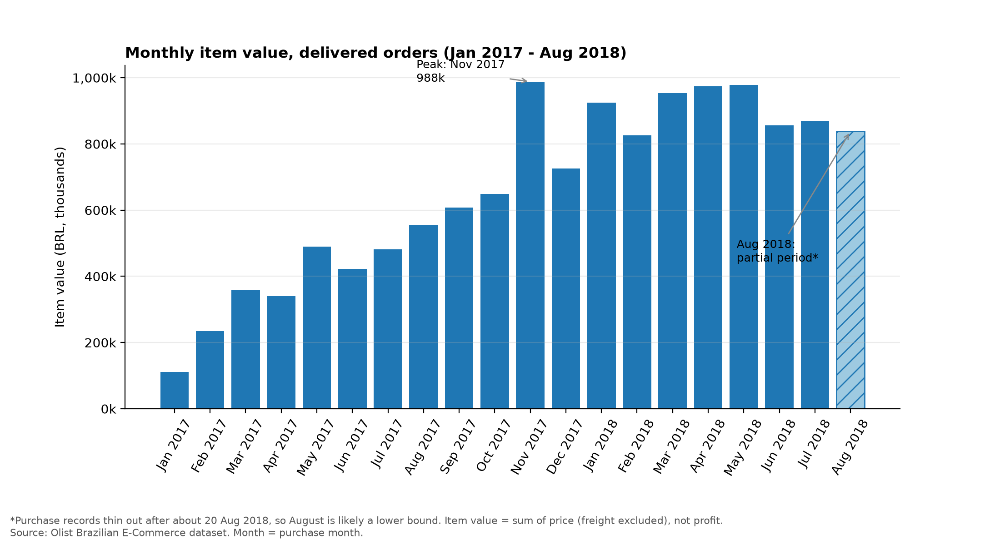
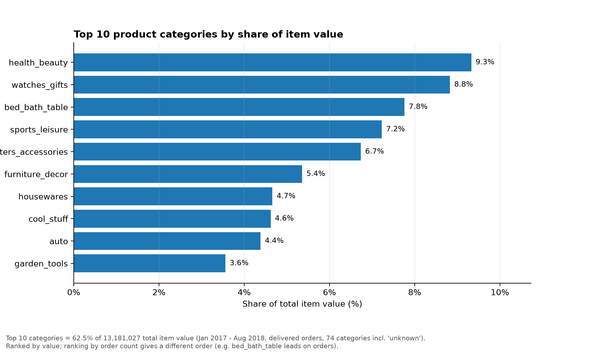
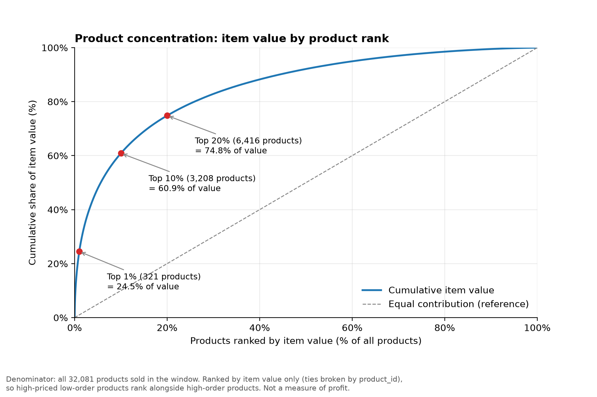

# Sales Intelligence System

A Python data-analysis project that turns raw e-commerce order data into
trustworthy sales metrics, monthly trends and product-performance findings.

Built with Python, pandas, NumPy and Matplotlib on the public
[Olist Brazilian E-Commerce dataset](https://www.kaggle.com/olistbr/brazilian-ecommerce).
This is an e-commerce **case study**. Its findings come from a Brazilian
marketplace, not from a real Nigerian retailer, and should be read that way.

## Key findings

All figures cover **delivered orders purchased from January 2017 to August 2018**
(13,181,027.13 BRL item value, excluding freight).

### 1. Monthly item value



Item value rose through 2017 and plateaued in 2018. The highest month was
November 2017. August 2018 is shown as partial, because purchase records thin out
after about 20 August.

### 2. Category contribution



The top 7 of 74 categories hold 49.90% of item value. `health_beauty` leads on
value, while `bed_bath_table` leads on number of orders, so the two rankings differ.

### 3. Product concentration



Value is concentrated: the top 1% of products (321) hold 24.5% of item value, the
top 10% hold 60.9% and the top 20% hold 74.8%. The long tail is still material.

### Other findings

- Products with 2 or fewer orders are 76% of products sold. Under a 90/180-day
  definition, 54% of them last sold more than 180 days before the dataset's end
  (43-67% across threshold choices). Their timing matches ordinary order timing
  (sole order in last 180 days: 44.1% vs 39.7% for all orders), so this mostly
  reflects one-off sales, not a dormant group.
- 270 products with 11+ orders had no sale in the last 180 days, across 171 sellers.
- A delivery-lag explanation for the thin end of August 2018 was tested and rejected.

## Method

1. **Data discovery.** One row in the order-items file is one item within an order.
2. **Joins.** Items, products, orders and category translations are merged with
   `validate="many_to_one"` and a row-count assertion, so joins cannot silently
   change what a row means.
3. **Definitions.** Only `delivered` orders count. Orders are counted by distinct
   `order_id`. Average order value uses order totals, not item rows.
4. **Date handling.** Purchase month comes from `order_purchase_timestamp`. Sparse
   2016 months and 2018-09 are kept in the data and excluded from trend charts.
5. **Missing categories.** 1,603 items without a category are labelled `unknown`
   (1.29% of window value), not dropped.
6. **Reconciliation.** Every total ties to the earlier milestone to the cent.

Detailed notes are in [`docs/`](docs/).

## Setup

You need Python 3.10 or newer. These commands are for Windows Git Bash.

```bash
git clone [your-repo-url]
cd sales-intelligence
python -m venv .venv
source .venv/Scripts/activate      # macOS/Linux: source .venv/bin/activate
pip install -r requirements.txt
```

### Get the data

The data is not included, because the licence (CC BY-NC-SA 4.0) restricts
redistribution. Download it from Kaggle, extract it, and copy these four files into
`data/raw/`:

- `olist_order_items_dataset.csv`
- `olist_products_dataset.csv`
- `olist_orders_dataset.csv`
- `product_category_name_translation.csv`

## Run

```bash
python src/run_all.py                      # core pipeline, writes figures/
python src/run_all.py --with-diagnostics   # also runs the data-quality checks
```

Scripts can also be run on their own, from the project root, for example
`python src/monthly.py`.

## Project structure

```
sales-intelligence/
├── data/raw/              # Olist CSVs (not tracked)
├── docs/                  # Notes: discovery, joins, metrics, time, product performance
├── figures/               # Charts used in this README
├── outputs/               # Generated tables (not tracked)
├── src/
│   ├── config.py              # Shared settings: statuses, date window, category column
│   ├── load_data.py           # Loads and merges the four tables, with integrity checks
│   ├── inspect_data.py        # Milestone 1: data inspection
│   ├── connect_data.py        # Milestone 2: join checks
│   ├── metrics.py             # Milestone 3: core metrics
│   ├── monthly.py             # Milestone 4: monthly analysis
│   ├── tail_diagnostic.py     # End-of-period investigation
│   ├── category_check.py      # Category translation checks
│   ├── product_performance.py # Milestone 5: categories and products
│   ├── product_recency.py     # Milestone 5.1: product recency
│   ├── recency_baseline.py    # Baseline and seller checks
│   ├── verify_claims.py       # Verifies the figures quoted in the docs
│   ├── charts.py              # Milestone 6: figures
│   └── run_all.py             # Runs the pipeline in order
└── requirements.txt
```

## Limitations

- **Item value is not profit.** The dataset has no cost or margin data.
- **No quantity column.** Row counts are reported as "item records", not units.
- **Order reach is not customer reach.** Counts show orders containing a product,
  not unique customers.
- **August 2018 is a lower bound.** Purchases thin out after about 20 August, and
  the dataset cannot say why.
- **2016 is sparse.** Sept-Dec 2016 have almost no delivered orders and are
  excluded from trend charts.
- **Recency is relative to the dataset's end (1 Sept 2018)**, not today. The data
  cannot show whether a product is discontinued, out of stock or still active.
- **Prices are in Brazilian reais** and not adjusted for inflation.

## Data and licence

Dataset: Olist, *Brazilian E-Commerce Public Dataset by Olist* (Kaggle), CC BY-NC-SA 4.0.
This project is for non-commercial, educational and portfolio use.